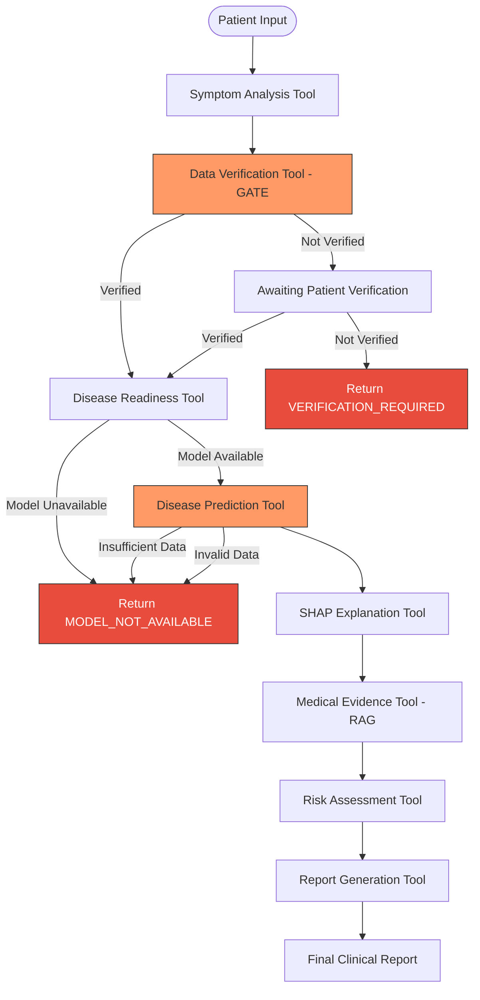
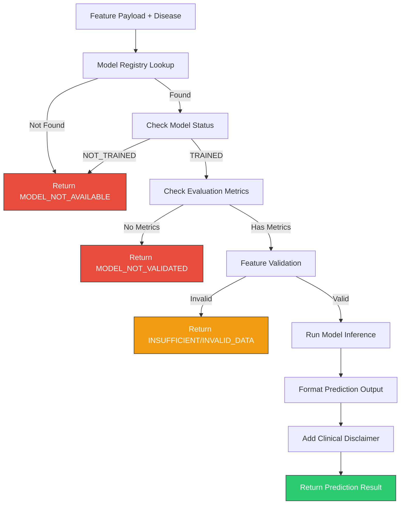
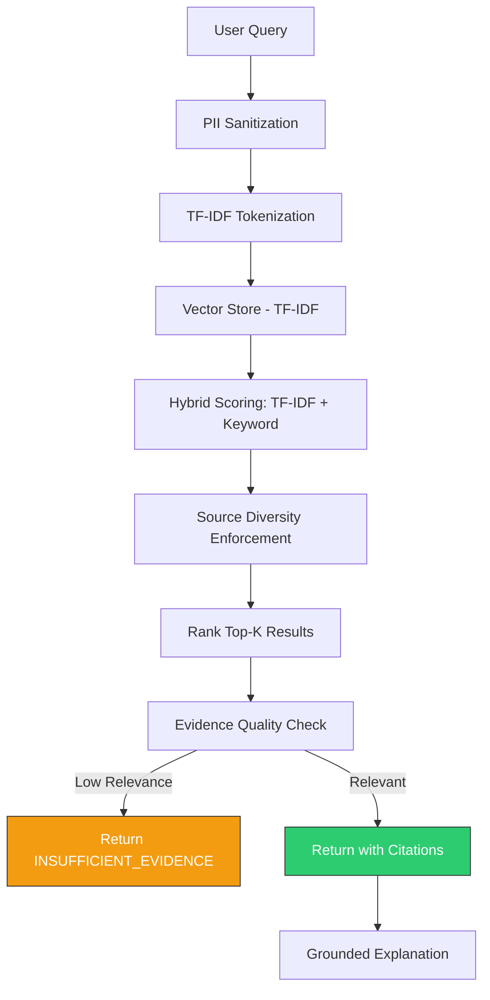
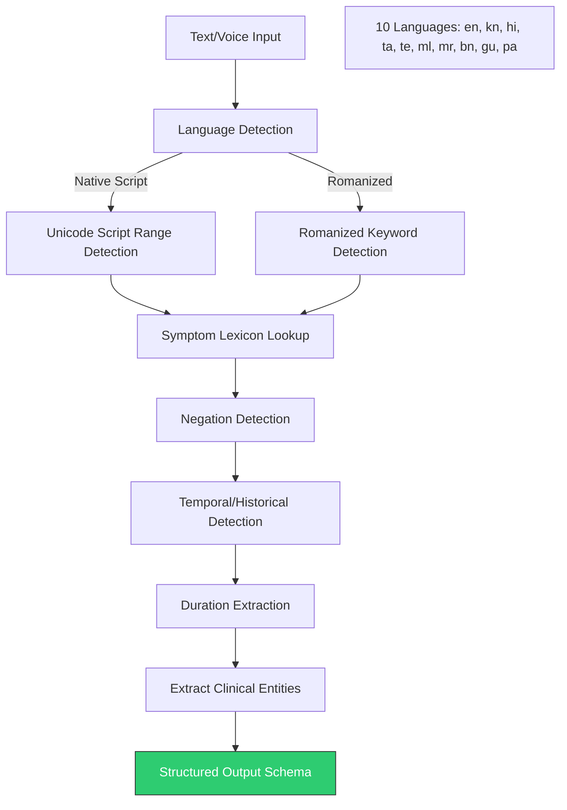
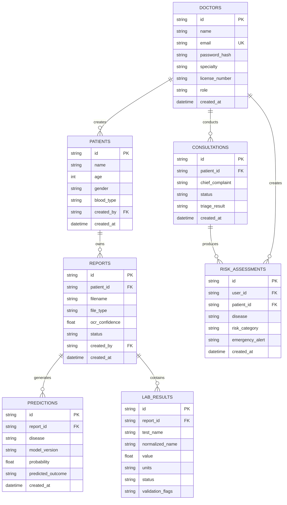
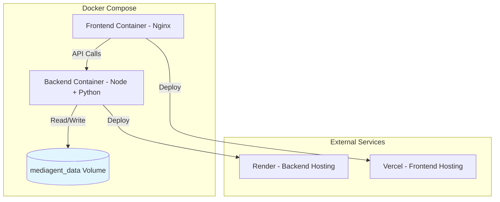

# MediAgent — System Architecture

This document describes the actual implemented system architecture based on source code.
All diagrams represent implemented components, not hypothetical features.

---

## 1. Overall System Architecture

```mermaid
graph TB
    subgraph Client [Frontend - React/Vite]
        UI[React UI Components]
        API[API Service Layer - api.js]
        Vite[Vite Dev Server / Nginx]
    end

    subgraph Backend [Backend - Express/Node.js]
        Server[Express Server - index.js]
        Auth[Auth Middleware - JWT]
        Cors[CORS Middleware]
        RateLimit[Rate Limiting]
        CorrID[Correlation ID Middleware]
        Logger[Structured JSON Logger]
    end

    subgraph APIRoutes [API Routes]
        AuthR[/api/auth]
        ReportsR[/api/reports]
        PatientsR[/api/patients]
        ML[/api/ml]
        Risk[/api/risk]
        RAG[/api/rag]
        Knowledge[/api/knowledge]
        Backup[/api/backup]
        Health[/api/health]
        HealthReady[/api/health/ready]
        HealthModels[/api/health/models]
        SystemStatus[/api/system/status]
        Orchestrator[/api/orchestrator]
        HealthComp[/api/health-companion]
        NLP[/api/nlp]
    end

    subgraph Services [Backend Services]
        DB[SQLite Database - better-sqlite3]
        PredSvc[Prediction Service]
        RAGSvc[RAG Service]
        VectorSvc[Vector Store - TF-IDF]
        ReportParser[Report Parser / OCR]
        Multilingual[Multilingual NLP - Python]
        HealthCompSvc[Health Information Agent]
    end

    subgraph ML [Python ML Layer]
        PredInterface[prediction_interface.py]
        ModelRegistry[model_registry.json]
        FeatureValidator[feature_validator.py]
        Models[5 Disease Models - .joblib]
    end

    subgraph Agents [Agentic AI - Server/agents]
        Orchestrator[orchestrator.js]
        Triage[Triage Agent]
        Diagnostic[Diagnostic Agent]
        RAGAgent[RAG Agent]
        Medication[Medication Agent]
        Image[Image Agent]
        Guardrail[Guardrail Agent]
    end

    UI --> API
    API --> Vite
    Vite -->|proxy /api| Server
    Server --> Auth
    Server --> Cors
    Server --> RateLimit
    Server --> CorrID
    Server --> Logger
    Server --> APIRoutes
    APIRoutes --> Services
    Services --> DB
    PredSvc --> ML
    Agents --> Orchestrator
    Orchestrator --> Triage
    Orchestrator --> Diagnostic
    Orchestrator --> RAGAgent
    Orchestrator --> Medication
    Orchestrator --> Image
    Orchestrator --> Guardrail
    ML --> Models
    ML --> ModelRegistry
```

---

## 2. Agentic AI Workflow



**Agent Responsibilities:**
- **Triage Agent:** Analyzes vitals and symptom urgency
- **Diagnostic Agent:** Generates differential diagnoses from symptom matching
- **RAG Agent:** Retrieves medical evidence from knowledge base
- **Medication Agent:** Checks treatments and drug interactions
- **Image Agent:** Analyzes uploaded medical images
- **Guardrail Agent:** Final safety and compliance validation

---

## 3. Laboratory Report Processing Pipeline

```mermaid
flowchart LR
    Upload[Upload Report - PDF/JPG/PNG] --> Multer[Multer - 15MB limit]
    Multer --> FileStore[Save to uploads/]
    FileStore --> Parser[Report Parser]
    Parser --> OCR[OCR - Tesseract.js / pdf-parse]
    OCR --> Extract[Extract Lab Values]
    Extract --> Normalize[Normalize Test Names/Units]
    Normalize --> Validate[Range Validation]
    Validate --> Map[Feature Mapping to Disease Schema]
    Map --> Readiness[Model Readiness Check]
    Readiness -->|Ready| Predict[Disease Prediction]
    Readiness -->|Not Ready| Ineligible[Prediction Ineligible]
    Predict --> SHAP[SHAP Explainability]
    SHAP --> RAG[RAG Medical Evidence]
    RAG --> Report[Clinical Report Generation]
    
    style Upload fill:#e1f5fe
    style Report fill:#e8f5e9
    style Ineligible fill:#ffebee
```



---

## 4. Disease Prediction Pipeline



**Supported Diseases:** Diabetes, Dengue, Malaria, Chikungunya, Typhoid (gated)

---

## 5. RAG Architecture



**Knowledge Base:** 5 diseases, curated sources (WHO, CDC, NHS, MoHFW, ICMR, ADA)

---

## 6. Multilingual NLP Workflow



---

## 7. Database ER Diagram



---

## 8. Data Flow Diagram

```mermaid
dfd
    User((User/Doctor)) -->|1. Upload Report| Frontend[React Frontend]
    Frontend -->|2. API Request| Backend[Express Backend]
    Backend -->|3. Store File| Uploads[(uploads/)]
    Backend -->|4. OCR Extraction| OCR[Tesseract.js / pdf-parse]
    OCR -->|5. Lab Values| DB[(SQLite Database)]
    DB -->|6. Feature Mapping| ML[Python ML Service]
    ML -->|7. Prediction| Backend
    Backend -->|8. RAG Evidence| RAG[RAG Knowledge Base]
    RAG -->|9. Citations| Backend
    Backend -->|10. Response| Frontend
    Frontend -->|11. Display| User
```

---

## 9. Use Case Diagram

```mermaid
useCaseDiagram
    actor Doctor
    actor Patient

    Doctor --> (Upload Lab Report)
    Doctor --> (View Predictions)
    Doctor --> (Review & Sign-off)
    Doctor --> (Manage Patients)
    Doctor --> (View System Status)
    Doctor --> (Backup/Restore)
    Patient --> (View Reports)
    Patient --> (Health Companion Chat)
    Patient --> (Multilingual Voice Input)
```

---

## 10. Deployment Architecture



---

## Implementation Notes

- **Backend:** Express.js with SQLite (better-sqlite3, WAL mode)
- **Frontend:** React 18 with Vite, served by Nginx in production
- **ML:** Python 3 with scikit-learn, joblib, SHAP
- **OCR:** Tesseract.js (frontend), pdf-parse (backend)
- **RAG:** TF-IDF hybrid vector search (no FAISS/embeddings)
- **Authentication:** JWT with bcrypt password hashing
- **Logging:** Structured JSON with correlation IDs and PII redaction
